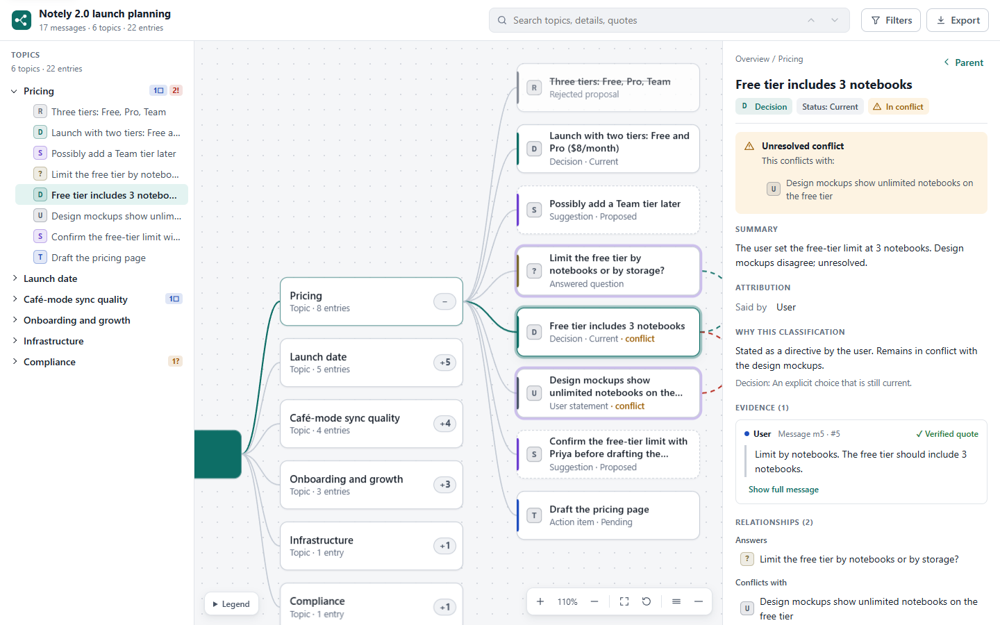

# Conversation Map

Turn a conversation or transcript into an interactive, evidence-linked knowledge map. Decisions, suggestions,
open questions, action items, corrections and conflicts are kept apart. Every claim links back to the
message it came from, and the quotes are checked against the transcript.

Conversation Map ships as a **Codex plugin** (one skill plus a bundled, dependency-free Node script). Its
output is a single self-contained HTML file that works offline in any modern browser, plus Markdown and JSON
exports.



## How it works

1. **Codex (the model) analyzes.** It reads the transcript and writes `analysis.json`: topics, classified
   items, verbatim evidence quotes, and relations. The [analysis guide](plugins/conversation-map/skills/conversation-map/references/analysis-guide.md)
   and [JSON Schema](plugins/conversation-map/skills/conversation-map/references/analysis.schema.json) define
   the format.
2. **The script checks the analysis.** `conversation-map.mjs` checks every quote against the cited message,
   reclassifies statements attributed to the wrong speaker, drops owners and due dates that don't appear in
   the cited text, applies corrections (superseded decisions), flags conflicts, and repairs the hierarchy.
   Whatever it changes is reported as an error or warning so the analyst can fix the draft.
3. **The script renders.** The validated map becomes `map.html` (interactive workspace), `map.md` and
   `map.json`.

The script never calls a model or the network, sends no telemetry, and reads only the files you pass to it.

## Install

The repository root is a plugin marketplace (`.agents/plugins/marketplace.json`) that points at
`plugins/conversation-map/`.

These steps follow OpenAI's [plugin build guide](https://developers.openai.com/codex/plugins/build). They
were **not** executed during development, because neither the Codex CLI nor the ChatGPT desktop app was
available in that environment.

- **Codex CLI:** `codex plugin marketplace add <path-to-this-repo>`, then run `codex`, open `/plugins`,
  install **Conversation Map**, and start a new session.
- **ChatGPT desktop app (Codex):** open this repository as the project and restart the app, so it picks up the
  repo marketplace. Then install Conversation Map from the Plugins Directory and start a new chat.
- **Personal install:** copy `plugins/conversation-map` to `~/.codex/plugins/conversation-map` and add an
  entry for it to `~/.agents/plugins/marketplace.json`.

The plugin needs **Node.js 18 or newer** wherever its script runs.

## Use

Ask Codex, for example:

- "Map this conversation with `$conversation-map`."
- "Turn `meeting-transcript.md` into a conversation map and list the open questions."

The skill writes `transcript.json` (if mapping the current chat), `analysis.json`, and the outputs to the
folder you name, or to `conversation-map/` by default.

### Run the script directly

```sh
CM=plugins/conversation-map/skills/conversation-map/scripts/conversation-map.mjs
node $CM ingest examples/launch-planning/transcript.md          # message ids to cite
node $CM check  examples/launch-planning/transcript.md examples/launch-planning/analysis.json
node $CM build  examples/launch-planning/transcript.md examples/launch-planning/analysis.json --out-dir out --name map
```

Supported transcript formats are JSON (an array, or `{"messages": [...]}`), JSONL, and text/Markdown with
`User:` / `Assistant:` style turn labels. Exit codes: `0` success, `1` usage or unreadable input, `2`
validation errors. `build` refuses to write while errors remain unless you pass `--best-effort`, which
applies the repairs and records them in the map.

## The viewer

- **Three panes:** a topic explorer (keyboard-navigable tree), a pan-and-zoom map canvas, and a details
  inspector. On narrow screens the panes become tabs.
- **Details for each entry:** classification and why it was chosen, who said it, owner and due date (only
  when stated), verified quotes that expand to the full message, relationships, and validation notes.
- **Overview:** counts, current decisions, open questions, pending actions, conflicts and superseded items.
- **Search and filters:** search across titles, details and quotes; filter by classification, status, or
  "needs attention" flags, with presets for open questions, pending actions, current decisions and
  unresolved items.
- **Links and exports:** deep links (`map.html#node=<id>`); export to self-contained HTML, Markdown or JSON;
  printing uses a clean outline.
- **Accessibility and fallbacks:** light and dark themes, reduced motion, forced-colors support, and a full
  static outline when JavaScript is disabled or the viewer fails.

Open [`examples/launch-planning/output/map.html`](examples/launch-planning/output/map.html) to try it.

## Develop

```sh
npm install
npm run check        # format check, typecheck, build, unit + integration tests, end-to-end tests
npm run examples     # regenerate examples/launch-planning/output
```

The source is TypeScript in `src/`, run directly by Node ≥ 22.18 during development and bundled by esbuild.
The bundled script in `plugins/.../scripts/conversation-map.mjs` is generated; do not edit it by hand.
End-to-end tests use Playwright with the installed Microsoft Edge or Chrome (`PW_CHANNEL` overrides the
browser channel).

## Documentation

- [Architecture and platform decision](docs/architecture.md)
- [Map data model (schema v1)](docs/schema.md)
- [Security and privacy](docs/security.md)
- [Evaluation](docs/evaluation.md)
- [Known limitations](docs/limitations.md)

## License

[MIT](LICENSE) © 2026 [Tony](https://github.com/tonitalej)
